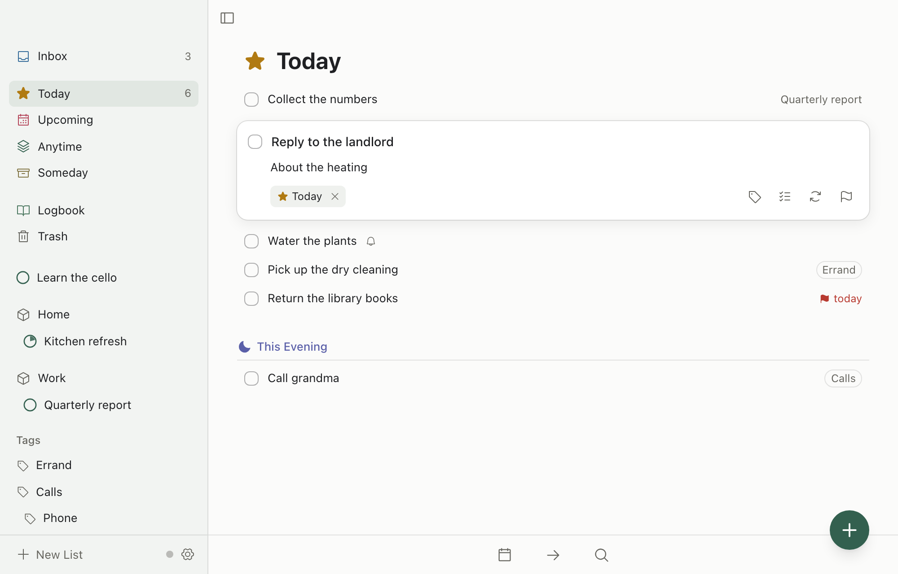

# stuff

A calm to-do app for the Mac. Inbox, Today and This Evening, Upcoming, Anytime, Someday, Logbook; areas, projects with headings, checklists, tags, deadlines, reminders and repeating to-dos. Everything lives on your Mac first. If you want, it syncs between your Macs over Nostr relays, end-to-end encrypted to your own key, or through a folder your cloud drive syncs. A `stuff` command line lets scripts and agents read and edit your to-dos.



stuff is early. It's a personal project that its author uses every day, but there are no releases or signed builds yet: you build it from source, and data formats may still change. Keep a backup (Settings → Backup).

- [Install](#install)
- [Using it](#using-it)
- [Sync and privacy](#sync-and-privacy)
- [The `stuff` CLI](#the-stuff-cli)
- [Extending stuff](#extending-stuff)
- [Development](#development)
- [License](#license)

## Install

stuff runs on macOS only (it uses the macOS keychain, notifications and a global shortcut). There are no prebuilt downloads yet, so build it yourself.

You need:

- macOS with the Xcode Command Line Tools (`xcode-select --install`)
- [Rust](https://rustup.rs) (stable)
- Node.js 22.5 or newer and [pnpm](https://pnpm.io) 11 (`corepack enable` picks the version pinned in `package.json`)

Then:

```sh
git clone https://github.com/leon-wbr/stuff.git
cd stuff
pnpm install
pnpm build
```

The app lands in `apps/desktop/src-tauri/target/release/bundle/macos/stuff.app`; drag it to Applications. The build is unsigned (or self-signed, see below), so the first time you open it, right-click it and choose Open.

Optional: `scripts/local-signing-identity.sh` creates a self-signed "Stuff Local Dev" code-signing identity in your login keychain, once. `pnpm build` signs with it when it exists, so the keychain keeps trusting the app across rebuilds instead of asking again for the sync key.

## Using it

- **Quick Entry**: Ctrl+Space from anywhere.
- **Keyboard**: ⌘N new to-do, Space new to-do below, ⌥⌘N new project, ⇧⌘N new heading, ⌘K complete, ⌥⌘K cancel, ⌘T Today, ⌘E This Evening, ⌘R Anytime, ⌘O Someday, ⌘S When, ⇧⌘D deadline, ⇧⌘M move, ⇧⌘T tags, ⇧⌘C checklist, ⇧⌘R repeat, ⌘D duplicate, ⌘Z undo, ⇧⌘Z redo, ⌃⌘S hide the sidebar, ⌘F Quick Find, ⌘1–⌘7 lists, ⌃⌘N new window. Start typing anywhere to jump to a list or to-do.
- **Right-click** anything (to-dos, a selection, projects, areas, headings, sidebar lists) for its actions; each shows its shortcut.
- **Drag** to-dos to reorder them or onto a list in the sidebar to move them; drag the + button to put a new to-do exactly where you want it.
- **Coming from Things 3**: Settings → Import from Things reads a `main.sqlite` from a Things backup, read-only. Share ▸ Copy Things Link copies selected to-dos or a whole project as a Things URL to paste into Things.
- **Backup**: Settings → Backup exports and restores stuff's own JSON. Restoring merges, so it never overwrites newer edits.
- **Themes**: Settings → Appearance. Several themes are built in, and you can add your own as JSON files (`docs/themes.md`).

## Sync and privacy

stuff has no server and no account. Sync is off until you choose an adapter in Settings → Sync, separately on each Mac:

- **Off** (the default): everything stays in a SQLite database on this Mac.
- **Nostr**: set up a key (created on this Mac, or import an `nsec` to use the same key as your other Macs). The key stays in the macOS keychain, and only the app's Rust side reads it. Each to-do, project, area, heading, tag, checklist item and the settings is its own Nostr event (NIP-78, kind 30078) with a random `d` tag, its content NIP-44 encrypted to your own key. Relays can see your public key, that the events belong to stuff (`t=stuff`), how many objects you have, roughly how large each is, and when each changed. They can't see titles, notes, dates, lists or tags. You choose the relays; the defaults are `relay.anchorman.lol`, `relay.nostr.net` and `relay.primal.net`.
- **Folder**: pick a folder that iCloud Drive, Google Drive, Dropbox or Syncthing syncs. stuff writes one `<id>.json` file per object and reads what your other Macs write. With "Encrypt with my key" each file is the same encrypted event Nostr uses. Without it, the files are plain JSON that your drive's provider can read.

Edits merge per field, so editing a title on one Mac and the notes on another keeps both. The status under Sync only says "Synced" when the last changes went out and the relays or folder could be reached. `docs/spec.md` describes the data model, event format and merge rules.

## The `stuff` CLI

`pnpm install-cli` builds the CLI and links it to `~/.local/bin/stuff`. It needs Node 22.5 or newer. It works on the same store as the app, safely while the app runs; the app shows CLI changes within a second and syncs them like its own.

Output is JSON (`{"ok":true,"result":…}`, or `{"ok":false,"error":…}` with exit code 1); add `--human` for short text. Items can be named by id, an id prefix of 6+ characters, or their exact title.

```sh
stuff commands                      # every command and its arguments, as JSON
stuff list today                    # also inbox, upcoming, anytime, someday, logbook, trash, projects, areas, tags
stuff list --project "Kitchen" --tag Errand
stuff add "Buy bulbs" --when today --project Kitchen --heading Build --tags Errand --checklist E27 --checklist dimmable
stuff add "Quarterly report" --type project --area Work --deadline 2026-12-15
stuff show 3f2a9c                   # notes, checklist, tags, project, area
stuff edit 3f2a9c --notes "Ask about dimmers" --deadline none
stuff complete 3f2a9c               # also cancel, reopen
stuff move 3f2a9c --to tomorrow     # a list, a date, or a project/area/heading
stuff delete 3f2a9c                 # to the Trash; --permanent deletes everywhere
stuff search "landlord"
stuff export > backup.json          # and: stuff import backup.json
```

`--db <path>` (or `STUFF_DB`) points it at another store; `STUFF_PROFILE` picks a profile's store like the app does.

## Extending stuff

Sync adapters, importers, exporters and commands are one small typed surface in `packages/core/src/extensions.ts`, and the built-ins use it. `docs/extensibility.md` describes it, how to write a sync adapter, and how the CLI and the app share the store.

## Development

`CLAUDE.md` has the layout, architecture and house rules; `docs/plan.md` what's done and next; `docs/parity.md` the feature checklist.

```sh
pnpm dev      # the app with hot reload (Vite on :1430)
pnpm test     # unit tests
pnpm gate     # lint, format check, typecheck, tests, cargo test, build
pnpm e2e      # folder + CLI end to end; STUFF_E2E_RELAY=ws://… adds Nostr
pnpm design   # design playground: the real UI with live theme controls, as one HTML file
```

Issues and pull requests are welcome. Run `pnpm gate` before opening one; lint and format are oxlint and oxfmt (`pnpm lint`, `pnpm fmt`).

## License

MIT, see [LICENSE](LICENSE).

stuff is not affiliated with or endorsed by Cultured Code. Things is a trademark of Cultured Code GmbH & Co. KG.
